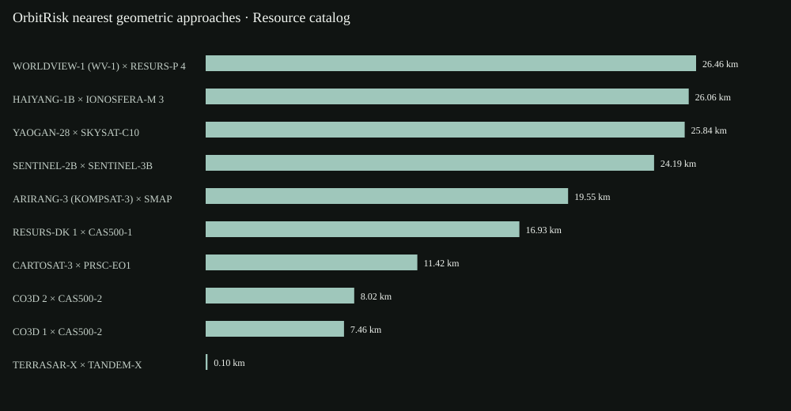

# OrbitRisk: Satellite Conjunction Risk Modeling

## Abstract

OrbitRisk demonstrates a transparent public-data workflow for satellite close-approach screening. It ingests an attributed CelesTrak Resource TLE snapshot, propagates compatible elements with SGP4 in the TEME inertial frame, screens object pairs geometrically, and refines candidate times of closest approach. Public TLE data lacks covariance, so real-data outputs are restricted to miss distance and relative velocity. A separate synthetic encounter-plane experiment demonstrates probability sensitivity under stated Gaussian assumptions.

## Data and propagation

The expanded catalog is CelesTrak GP Resource data (`GROUP=resource`), retrieved 2026-11-16T21:09:14Z. It contains 167 valid TLE records after parser validation. Each record retains NORAD ID, name, source TLE lines, epoch, inclination, eccentricity, and mean motion. SGP4 produces TEME position and velocity in kilometers and km/s. TEME is not treated as an Earth-fixed frame. The source URL, retrieval time, object count, filtering criteria, and SHA-256 snapshot checksum are published through the API.

## Screening method

For each object pair, states are sampled at a 10-minute interval during a bounded prediction window. Pairs whose coarse minimum is plausibly near the screening threshold are refined by bounded scalar minimization of relative Euclidean distance. The resulting TCA, miss distance, and relative velocity are geometric estimates. This is a research screen rather than a conjunction-data-message or operational screening service.

## Verified screening results

The 24-hour Resource-catalog replay evaluates 13,861 unique object pairs. The
1,000 km alert screen retained 5,738 geometric candidates. The nearest ranked
pair was TERRASAR-X / TANDEM-X at 0.0999 km minimum separation and 0.0004
km/s relative velocity at 2026-11-17T00:29:05Z. The ranking uses a separate
2,000 km ceiling and is not a collision-probability estimate. Attached or
co-located modules are excluded from duplicate-TLE candidate screening and are
identified as catalog relationships when interpreting minima.

The figure is generated from `reports/nearest_approaches.csv` and the verified
static snapshot. It reports sampled geometric proximity only; public TLEs do
not provide covariance or an operational conjunction assessment.

## Synthetic uncertainty experiment

For a controlled two-dimensional encounter plane, a Gaussian relative-position distribution with an explicit mean offset of two standard deviations is sampled with a fixed random seed. A hard-body radius gives a Monte Carlo collision frequency. The noncentral chi-square CDF is also reported under the same isotropic assumptions. These results are illustrative, not attached to any public-TLE event.

## Validation and limitations

The test suite confirms that the preserved catalog parses, produces a valid SGP4 state vector, and yields reproducible seeded Monte Carlo output. It does not claim operational accuracy. Public TLE epochs can be stale, orbital state errors grow with time, and covariance is unavailable. Operational use requires authoritative state vectors, covariance, independent screening, and mission-specific hard-body models.

## References

1. CelesTrak. GP Data Formats and Sources. https://celestrak.org/NORAD/documentation/gp-data-formats.php
2. Vallado, D. A. et al. Revisiting Spacetrack Report #3. AIAA 2006-6753.
3. Hoots, F. R., and Roehrich, R. L. Models for Propagation of NORAD Element Sets. Spacetrack Report No. 3, 1980.
